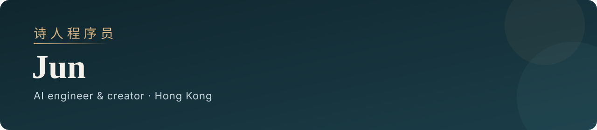

  

  <a href="README.md">English</a> · <strong>中文</strong>
    
  <a href="https://www.linkedin.com/in/huzujun/">LinkedIn</a>
  · <a href="https://x.com/poet_coder">X</a>
  · <a href="https://www.xiaohongshu.com/user/profile/5b40fe744eacab72c9f480ef">小红书 · 诗人程序员 Jun.AI</a>
  · <a href="https://poetcut.online/">PoetCut</a>

我在香港做 AI 工程师和创作者。公开作品大多是 **Agent Skill**：把它装进你的个人 Agent，一段口播、一场会议、一次求职，就能变成你能审、能改、能真正拿去用的成品。

## 开源的 Agent Skill

### [DraftCut](https://github.com/PoetCoderJun/DraftCut)

先开口，保留你的原声。Agent 帮你理掉口头禅、口误和重复，再配上字幕、图解和节奏，做成一条精炼的口播视频。

### [DingTalk-style Minutes](https://github.com/PoetCoderJun/dingtalk-style-minutes)

手机备忘、会议或采访录音，都能变成钉钉闪记风格的飞书图文纪要：内容概览、带证据的纪要，以及完整时间戳转写。

### [linkedin-apply-for-agents](https://github.com/PoetCoderJun/linkedin-apply-for-agents)

给个人 Agent 用的 LinkedIn 自动投递技能。先说投递地区；如果是香港，会自动同时投 JobsDB。

## 正在线上

[PoetCut](https://poetcut.online/) 是我做的中文口播剪辑工具：上传原始录像，自动删废话，导出带字幕和章节的成片。

## 我怎么做

我不追求只能看一眼的演示，更在意一套你能检查的工作流：计划可以审批，证据可以核对，成品可以继续用。
